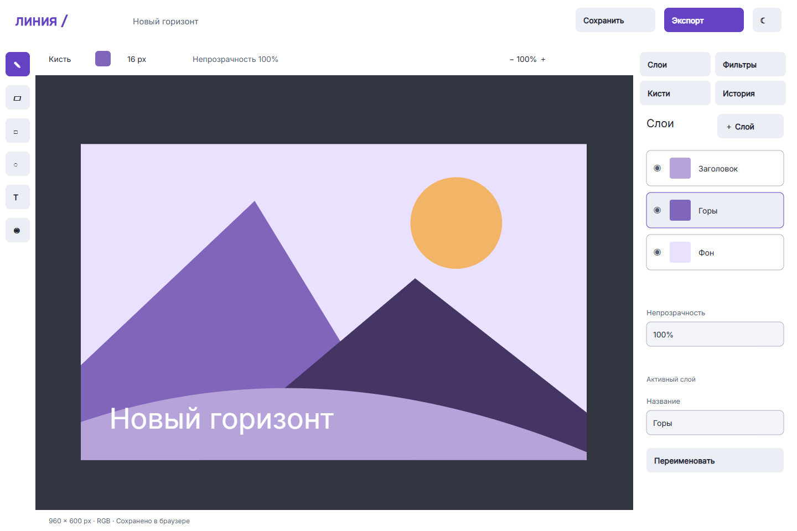

# Линия: проект интерфейса графического редактора

Лабораторная работа S2G11 «Проект интерфейса программной системы». Вариант №3: графический редактор.

**Автор:** Быстряков Роман Константинович



**[Прототип Figma](https://www.figma.com/proto/FPaA4Y8YO1qcxkyT9T2xvW?node-id=2-299&starting-point-node-id=2%3A299&scaling=contain)** · **[Файл Design](https://www.figma.com/design/FPaA4Y8YO1qcxkyT9T2xvW)**

## Что внутри

- Техническое задание по структуре методички с ролями и уровнями доступа.
- Аналитическое исследование аудитории, персон, конкурентов и устройств.
- 12 сценариев, UML Use-Case, четыре листа User Flow с экранами, карта потоков на А4.
- 13 схем зон и 23 финальные монохромные схемы: экраны и состояния.
- Три moodboard, два UI-кита, все основные экраны в двух темах.
- 102 SVG и 102 PNG: desktop, четыре tablet-экрана и две ориентации телефона.
- Три векторных PDF, включая единый отчёт со всеми материалами.
- Токены JSON/CSS, расчёт контраста, Inter 400–700, логотип, восемь оригинальных значков, спрайт и иконочный шрифт.
- Статический каталог материалов в site/. Работающий редактор по условию пользователя не разрабатывается.

## Обязательные пункты задания

| Пункт | Где |
|---|---|
| Техническое задание | [01-tech-spec.md](docs/01-tech-spec.md) |
| Исследование | [02-research.md](docs/02-research.md) |
| Сценарии и Use-Case | [03-user-scenarios.md](docs/03-user-scenarios.md) |
| User Flow и Flow Map | [04-ia-userflow.md](docs/04-ia-userflow.md) |
| Прототипы | [05-prototyping.md](docs/05-prototyping.md) |
| Moodboard и UI-киты | [06-style-moodboard.md](docs/06-style-moodboard.md) |
| Экраны | [07-screens.md](docs/07-screens.md) |
| Анимация | [08-motion.md](docs/08-motion.md) |
| Передача разработчикам | [09-handoff.md](docs/09-handoff.md) |
| Отчёт и сдача | [10-report-and-delivery.md](docs/10-report-and-delivery.md) |
| Полный отчёт | [00-full-report.md](docs/00-full-report.md) |

Дополнительно: [доступность](docs/a11y.md), [тексты](docs/content.md), [адаптивность](docs/responsive.md), [приложение](docs/11-appendix.md), [сравнение с эталоном](docs/comparison.md).

## Экраны

| Код | Экран | Светлая | Тёмная |
|---|---|---|---|
| S1 | Вход и регистрация | [SVG](design/export/svg/S1_Light.svg) | [SVG](design/export/svg/S1_Dark.svg) |
| S2 | Мои проекты | [SVG](design/export/svg/S2_Light.svg) | [SVG](design/export/svg/S2_Dark.svg) |
| S3 | Рабочая область | [SVG](design/export/svg/S3_Light.svg) | [SVG](design/export/svg/S3_Dark.svg) |
| S4 | Слои | [SVG](design/export/svg/S4_Light.svg) | [SVG](design/export/svg/S4_Dark.svg) |
| S5 | Фильтры | [SVG](design/export/svg/S5_Light.svg) | [SVG](design/export/svg/S5_Dark.svg) |
| S6 | Экспорт | [SVG](design/export/svg/S6_Light.svg) | [SVG](design/export/svg/S6_Dark.svg) |
| S7 | История документа | [SVG](design/export/svg/S7_Light.svg) | [SVG](design/export/svg/S7_Dark.svg) |
| S8 | Кисти и палитра | [SVG](design/export/svg/S8_Light.svg) | [SVG](design/export/svg/S8_Dark.svg) |
| S9 | Настройки | [SVG](design/export/svg/S9_Light.svg) | [SVG](design/export/svg/S9_Dark.svg) |
| S10 | Шаблоны | [SVG](design/export/svg/S10_Light.svg) | [SVG](design/export/svg/S10_Dark.svg) |
| S11 | Администрирование | [SVG](design/export/svg/S11_Light.svg) | [SVG](design/export/svg/S11_Dark.svg) |
| S12 | Смартфон, портрет | [SVG](design/export/svg/S12_Light.svg) | [SVG](design/export/svg/S12_Dark.svg) |
| S12 | Смартфон, альбомная | [SVG](design/export/svg/S12_Landscape_Light.svg) | [SVG](design/export/svg/S12_Landscape_Dark.svg) |

Планшет: рабочая область, слои, фильтры и экспорт, файлы `S3_Tablet_*`–`S6_Tablet_*`. Все превью: [галерея](design/export/gallery.html).

## PDF

[Linia_Otchet.pdf](design/export/Linia_Otchet.pdf) — текст и все материалы; [Linia_Makety.pdf](design/export/Linia_Makety.pdf) — макеты и прототипы; [Linia_Diagrammy.pdf](design/export/Linia_Diagrammy.pdf) — UML и потоки. Текст и фигуры векторные.

## Прототип и каталог

Открыть ссылку Figma → Войти → Новый проект → Создать → Слои / Фильтры / История → Экспорт → Скачать. Основной путь проверен кликами в Present. Ввод, рисование и скачивание представлены заранее подготовленными состояниями. Часть инструментов показана как элементы макета, а не как полноценный графический движок.

`site/index.html` — локальная карта материалов, страницы экранов, состояний, прототипов, UI-китов, moodboard и диаграмм. В ней нет кода рисования или обработки изображений. Эта граница отличается от работающего приложения в ФинКомпасе согласно уточнению задания.

## Палитра

| Токен | Light | Dark |
|---|---|---|
| Акцент | #6541C4 | #B5A1FF |
| Фон | #F3F4F8 | #11131A |
| Поверхность | #FFFFFF | #1C1F29 |
| Основной текст | #202332 | #F0F2FA |
| Вторичный текст | #535E75 | #B2BDD2 |

Полный состав: [tokens.json](tokens/tokens.json), [tokens.css](tokens/tokens.css). Контраст: [contrast.json](tokens/contrast.json), двенадцать проверенных пар удовлетворяют 4.5:1.

## Структура

```text
linia-ui/
├── docs/              отчёт по разделам и спецификации
├── design/export/     SVG, PNG, PDF и проверка
├── tokens/            цвет, шрифт, размеры, отступы, движение
├── assets/            логотип, значки, спрайт и шрифты
├── site/              статический каталог и копии материалов
└── tools/             генерация, экспорт и проверка прототипа
```

## Проверка и ограничения

[verification.json](design/export/verification.json) проверяет наличие материалов, цели и границы областей, выход текста за внешний фрейм. Это структурные проверки, не 207 независимых пользовательских тестов. [figma-verification.json](design/export/figma-verification.json) фиксирует реально выполненную проверку Figma.

Исследование аналитическое, без интервью. Variables, опубликованная библиотека компонентов и Zeplin не заявляются. Отдельная синхронизация новых макетов Figma зависит от доступа к редактору; актуальный статус указан в сравнении с эталоном.

Перед сдачей заполнить поля в квадратных скобках, сверить титульный лист с шаблоном вуза, приложить снимки конкурентов при необходимости и открыть преподавателю доступ к Figma.

## Пересборка и лицензии

Node.js, Chrome, `npm install`, `npm run build`, `npm run verify`. Для нестандартного Chrome задать CHROME_PATH. Для зависимостей в отдельной папке — LINIA_TOOLS. Пиктограммы и шрифт: `python tools/icons.py` (fonttools, brotli).

Материалы — [MIT](LICENSE), шрифт Inter — [SIL OFL](assets/fonts/OFL.txt). Все материалы «Линии» оригинальные; структура комплекта сверена с ФинКомпасом, исходники старого редактора не использованы.
