# 7. Оформление экранов

## S1. Авторизация и регистрация

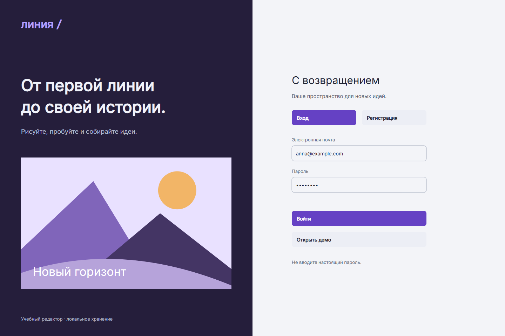

Левая половина даёт название и визуальную метафору, правая содержит форму. Порядок: заголовок, переключение вход/регистрация, почта, пароль, основная кнопка, демо. Дополнительное состояние регистрации содержит имя. Важно обозначить демонстрационность входа, не обещать реальную отправку пароля или OAuth.

**Расположение и поведение.** На desktop форма занимает правую половину. При сжатии описательный блок скрывается раньше полей. Ошибку нельзя показывать только красной границей; текст остаётся рядом с полем.

## S2. Мои проекты

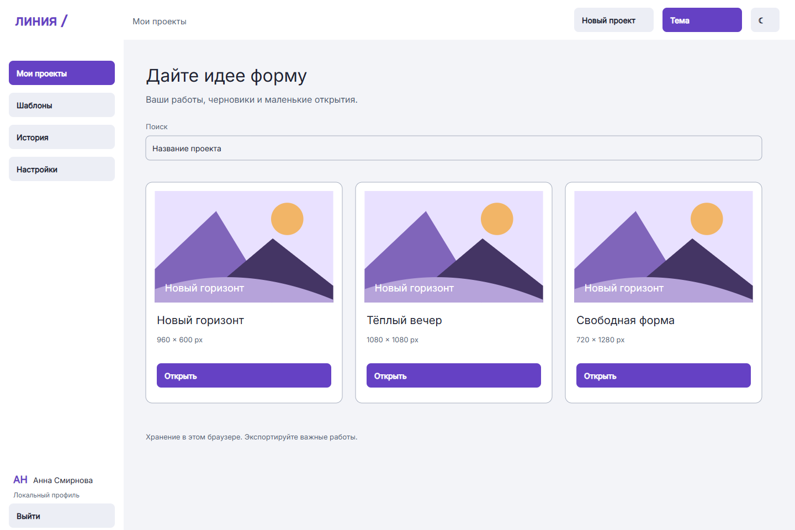

Верхняя панель содержит создание, меню слева — коллекции и настройки. В контенте заголовок, поиск и три карточки с названием и размерами. Кнопка «Открыть» ведёт к рабочей области. Пустое состояние объясняет следующий шаг: создать или выбрать шаблон. Миниатюра служит ориентиром, а не заменяет название.

**Расположение и поведение.** Карточки имеют одинаковую высоту, размеры проекта — вторичный текст. Создание закреплено в шапке. Пустое состояние ведёт к форме или шаблонам и не оставляет пользователя без действия.

## S3. Рабочая область

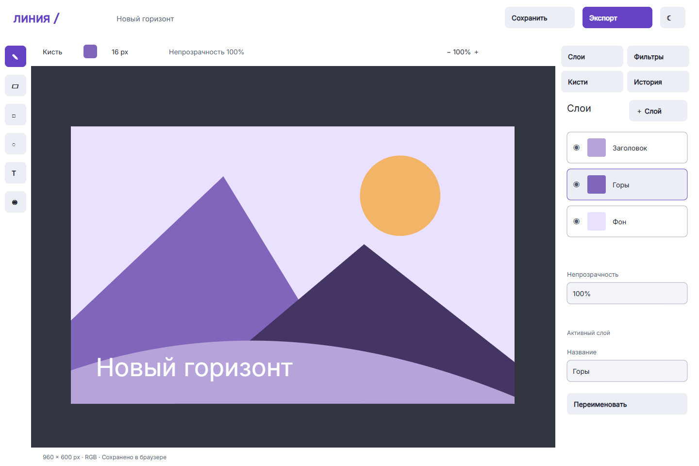

Холст — крупнейшая зона. Слева инструменты, над холстом цвет, размер и масштаб, справа слои. В шапке сохранение и экспорт. Статус под холстом показывает размеры и режим RGB. Команды документа должны оставаться стабильными при переключении панелей. Демонстрационная композиция содержит горы, солнце и заголовок.

**Расположение и поведение.** Рабочая область показывает один документ 960 × 600 px. Общая геометрия и название сохраняются в состояниях S4–S8. На планшете панель перенесена вниз, поэтому холст получает всю доступную ширину.

## S4. Слои

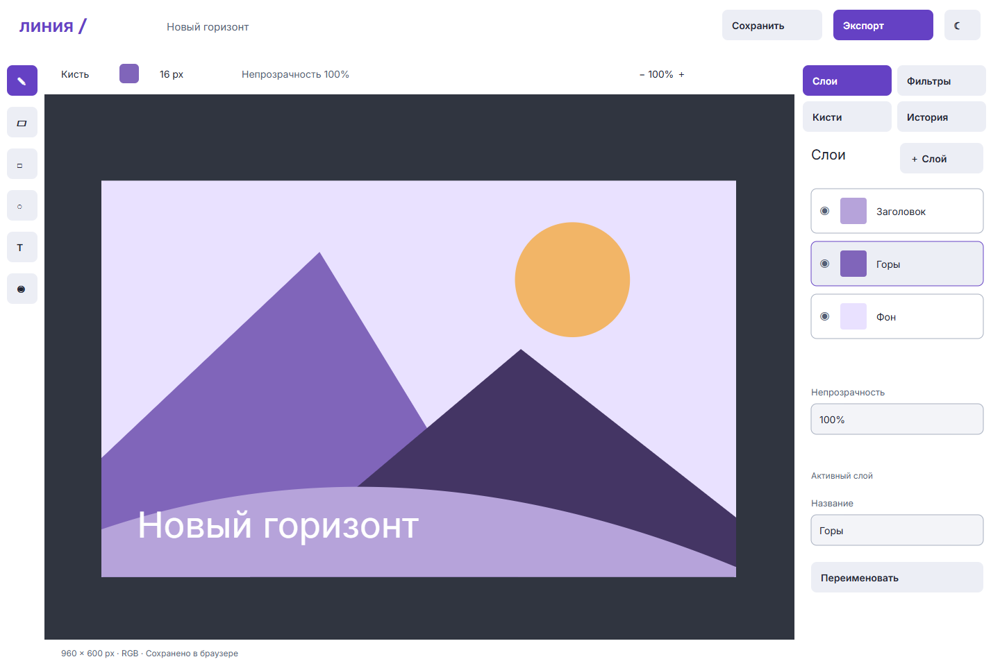

Панель показывает «Заголовок», «Горы», «Фон». Активный слой выделен границей. Отдельно обозначены видимость, миниатюра и название. Ниже непрозрачность и переименование. Изменение слоя ведёт к подтверждающему состоянию. У будущей реализации нужны предупреждения об удалении последнего слоя и отмена удаления.

**Расположение и поведение.** Каждая строка сочетает видимость, миниатюру и название. Состояние ST_Layer показывает скрытый элемент композиции: результат заметен на самом холсте, а не только в уведомлении.

## S5. Фильтры и эффекты

Эффекты названы результатом: чёрно-белый, тёплый свет, негатив, светлее, контрастнее, сепия. Перед выбором ясно указано, что изменяется активный слой. Применение ведёт к состоянию с подтверждением и переходом к истории. Финальный продукт должен давать предпросмотр и возможность отказаться до применения.

**Расположение и поведение.** Для демонстрации выбран «Тёплый свет»: меняются цвета композиции и появляется подтверждение. Это иллюстрирует область воздействия эффекта; остальные плитки показывают каталог возможных команд.

## S6. Экспорт

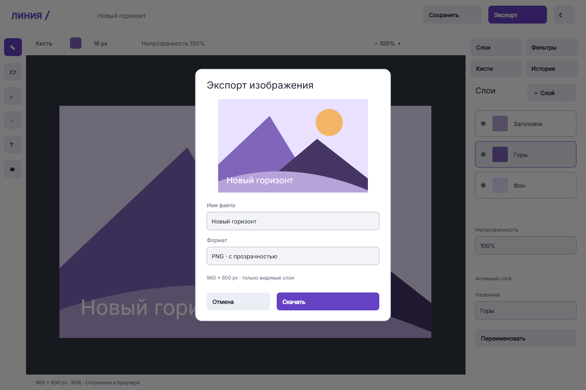

Диалог над затемнённым редактором: заголовок, превью, имя, формат, размеры, отмена и скачивание. По умолчанию PNG с прозрачностью. Текст «только видимые слои» объясняет результат. После скачивания показано подтверждение. Это имитация завершения, не настоящая загрузка файла из Figma.

**Расположение и поведение.** Кнопка отмены возвращает к редактору. После подтверждения открывается отдельное состояние результата. На планшете диалог сохраняет поля 44 px и не перекрывает доступ к своей кнопке закрытия.

## S7. История

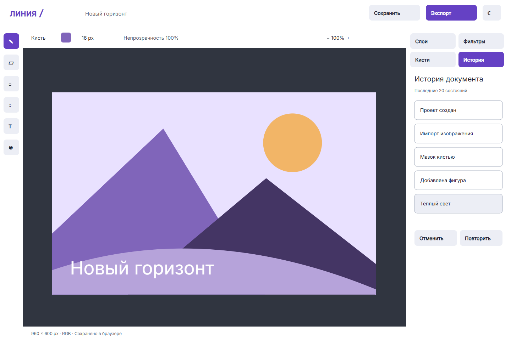

Отдельная вкладка редактора, хронологический список: создание, импорт, мазок, фигура, эффект. Текущее состояние отмечено. «Отменить» и «Повторить» образуют понятную пару. В пустой истории эти действия должны быть недоступны; в демонстрационном документе действия уже есть.

**Расположение и поведение.** Список связан с текущим документом. Отмена эффекта возвращает к исходной композиции. Место текущего шага выделено подписью; для будущего продукта предусмотрено отключение отмены при пустой истории.

## S8. Кисти и палитра

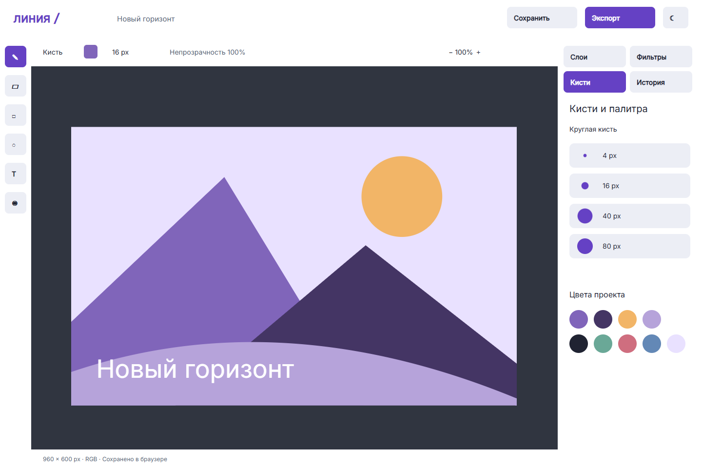

Список базовых размеров 4, 16, 40 и 80 px с образцом толщины. Палитра из десяти цветов повторяет цвета иллюстрации. Название панели не означает наличие сложной библиотеки текстурных кистей. Выбранная кисть должна отражаться в параметрах над холстом.

**Расположение и поведение.** Размер кисти показан числом и образцом толщины. Палитра повторяет цвета документа, а не случайные декоративные оттенки. Нельзя различать выбранный цвет только по его насыщенности.

## S9. Настройки

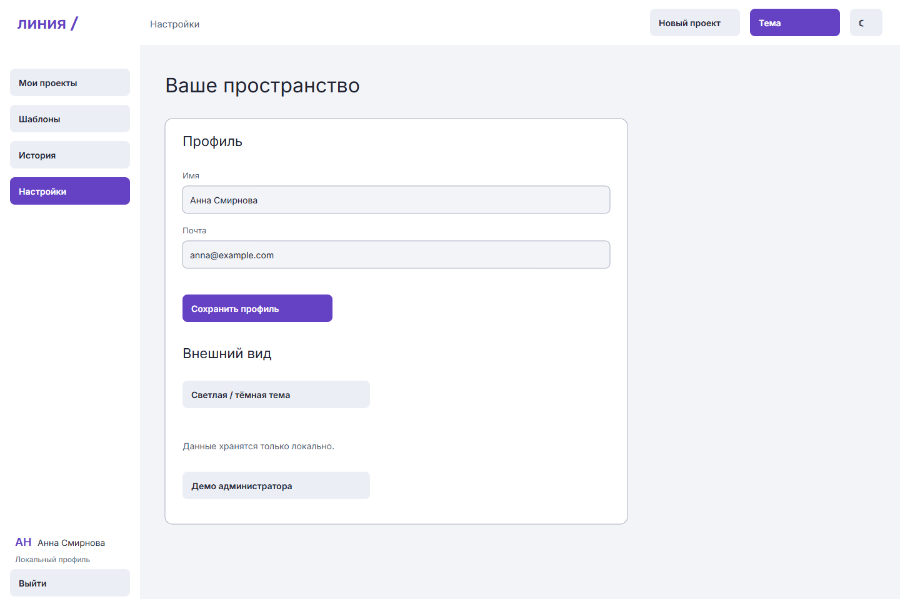

Профиль с именем и почтой, сохранение, тема и информация о данных. Служебный переход к демо администратора помечен как учебный. Аккаунт не следует автоматически считать облачной синхронизацией. Выход возвращает к авторизации.

**Расположение и поведение.** Профиль, оформление и данные разделены заголовками. Важно не путать настройки документа и аккаунта. Переключение темы сохраняет положение элементов.

## S10. Шаблоны

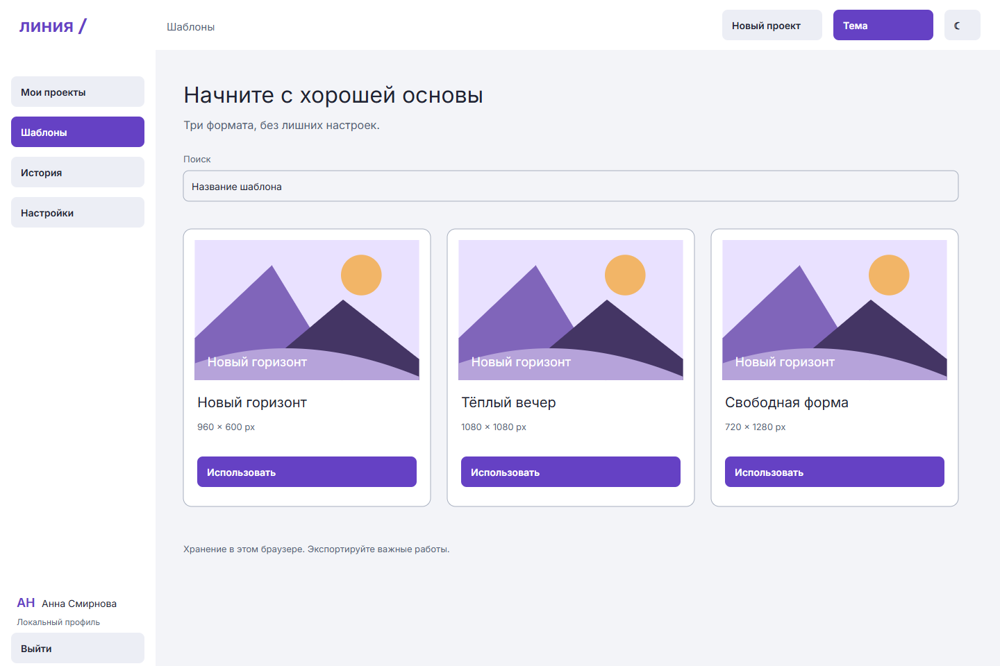

Три стартовых формата: открытка 960 × 600, публикация 1080 × 1080, история 720 × 1280. Карточка показывает превью и размер до выбора. Кнопка «Использовать» ведёт к документу. На этапе прототипа используется одна композиция, будущая библиотека расширяется после исследования.

**Расположение и поведение.** Размеры видны до применения шаблона. После выбора пользователь переходит к холсту, где доступен тот же набор инструментов. Шаблон — стартовое состояние, а не отдельный режим ограниченной работы.

## S11. Администрирование

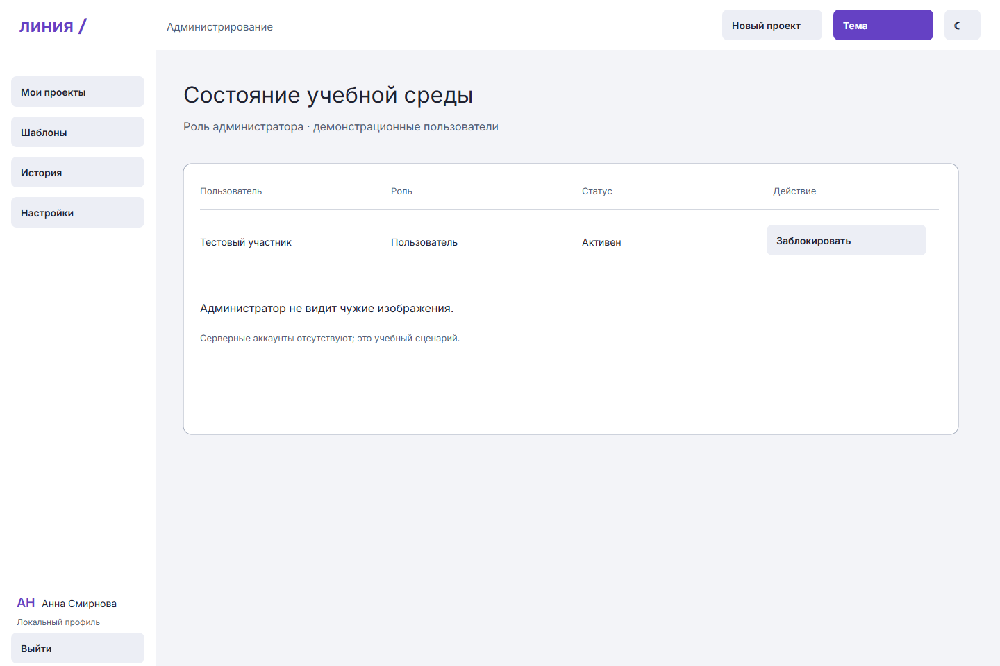

Таблица содержит демонстрационного участника, роль, статус и действие блокировки. Область не показывает изображения пользователя. Отдельное состояние подтверждает изменение статуса. Для настоящего сервиса нужны аудит, подтверждения и серверная проверка прав.

**Расположение и поведение.** Блокировка меняет статус в таблице и показывает подтверждение. При проектировании серверной версии необходимо добавить причину и аудит. Пользовательские изображения в этой области не показываются.

## S12. Мобильная рабочая область

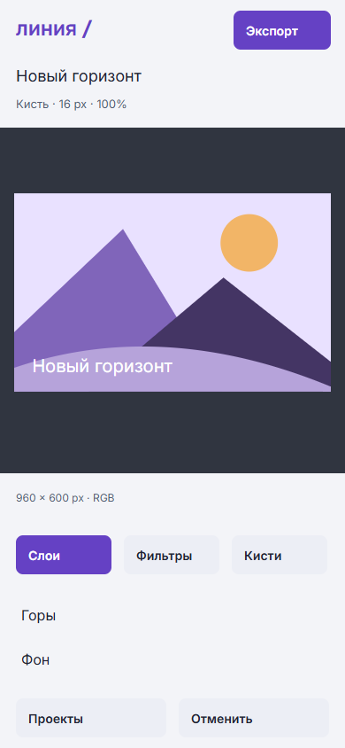

390 × 844 px: название и экспорт сверху, холст в центре, переключение слоёв, фильтров и кистей внизу. Внизу также проекты и отмена. Элементы располагаются для касания, текст не уменьшается пропорционально desktop. Мобильная версия — самостоятельный адаптивный макет; глубина мобильного сценария фиксируется в итоговой проверке.

**Расположение и поведение.** Добавлена альбомная ориентация 844 × 390: компактная шапка, инструменты слева и узкая панель справа. Для обеих ориентаций есть схемы зон и финальные монохромные варианты.

## Состояния

В двух темах показаны новый проект, ошибка размера, регистрация, пустой список, сохранение, экспорт завершён, фильтр применён, отмена, изменение слоя и блокировка. Основное действие в ошибке ведёт к восстановлению пути. Уведомления не должны быть единственным местом хранения важного результата.

## Планшетные варианты

| Экран | Фреймы | Компоновка |
|---|---|---|
| Рабочая область | S3_Tablet_Light / Dark | Шапка, инструменты, широкий холст, панель снизу |
| Слои | S4_Tablet_Light / Dark | Крупные карточки слоёв под холстом |
| Фильтры | S5_Tablet_Light / Dark | Сетка эффектов под холстом |
| Экспорт | S6_Tablet_Light / Dark | Диалог поверх контекста документа |

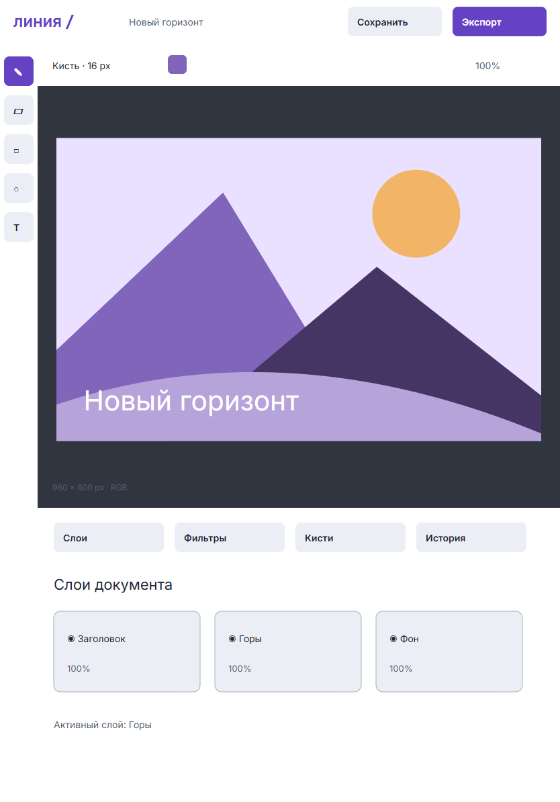
